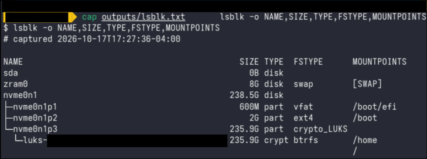
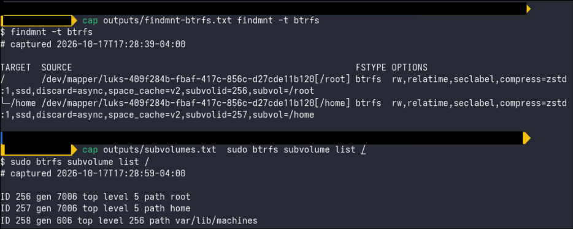
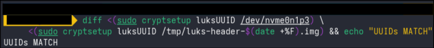
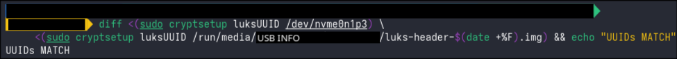

# 01 Disk layout

- Fedora version: 44

## Findings

**Partition layout** (`outputs/lsblk.txt`)

- `nvme0n1p1`, 600M: EFI system partition (vfat), mounted at `/boot/efi`
- `nvme0n1p2`, 2G: `/boot` (ext4), not encrypted
- `nvme0n1p3`, 235.9G: type `crypto_LUKS`. Unlocks to `luks-<uuid>` (type `crypt`), which holds the btrfs filesystem.
- `sda`, 0B: a disk with no media in it, most likely the built-in SD card reader.



**Encryption** (`outputs/lsblk.txt`, `outputs/crypttab.txt`, `outputs/luksdump-trimmed.txt`)

- LUKS is on. The `crypt` layer sits between the partition and btrfs, so everything except `/boot` and `/boot/efi` is encrypted at rest.
- `/etc/crypttab` lists `luks-<uuid>`, which is what tells the system to ask for my passphrase and unlock it at boot.
- LUKS2, cipher `aes-xts-plain64` with a 512-bit key. XTS splits the key in half, so this is AES-256.
- Key derivation is `argon2id`, the modern memory-hard default, which makes passphrase guessing slow and expensive.
- Keyslots in use: 1

**btrfs layout** (`outputs/findmnt-btrfs.txt`, `outputs/subvolumes.txt`)

- One btrfs filesystem, mounted twice: `/` is `subvol=/root` (ID 256) and `/home` is `subvol=/home` (ID 257). They are not separate partitions; they share the same 235.9G of space.
- A third subvolume, `var/lib/machines` (ID 258), sits inside `root` ("top level 256"). It is created for systemd's container tooling, so containers can be snapshotted or removed without touching the rest of the system.
- Mount options include `compress=zstd:1` (transparent compression), `ssd`, and `discard=async` (TRIM sent to the SSD in the background).



**Swap** (`outputs/swap.txt`)

- 8G of swap on `/dev/zram0`. This is not a disk partition: zram is a compressed block device that lives in RAM. There is no swap on the SSD.

**Why `/boot` is not encrypted**

- The kernel and the initramfs live in `/boot`. The initramfs is the small early system that contains the program that asks for my passphrase and unlocks the disk. It has to be readable before anything is unlocked, so `/boot` cannot be inside the encrypted partition.

## Explain It

Answered from memory first, then corrected.

### Q1. What is the difference between a partition and a btrfs subvolume?

**From memory:** Main difference is that in btfs subvolumes theres luks and has the info for the LUKS which encrypts all the files that are on the machine. Partitions only segment the avaliable storage on the machine to different things like /boot, /boot/efi in my case.

**Corrected:** LUKS is not inside the subvolumes; it sits underneath btrfs. The layers on this disk, bottom to top: disk `nvme0n1` > partition `nvme0n1p3` > LUKS container > btrfs filesystem > subvolumes `root` and `home`. A **partition** is a fixed-size region of the disk, defined in the partition table (GPT), and each one gets its own filesystem. A **subvolume** is a separately mountable directory tree _inside one btrfs filesystem_. Subvolumes have no fixed size, share the filesystem's free space, and can be snapshotted on their own. My part about partitions splitting the disk into areas like `/boot` and `/boot/efi` was right.

### Q2. Walk through boot from power button to login: where does the LUKS passphrase prompt come from, and what happens after you type it?

**From memory:** when the power gets turned on the /boot/efi boots up first that has the bootloader on it which basically is the thing used to connect the physical devices to the actual OS. Once the keyboard mouse and monitor's are up and running the LUKS passphrase comes up as the bootloader is trying to access the actual files on the machine that are not included in /boot or /boot/efi. Once thats typed in the passphrase goes to the /dev/nvme0n1p3 part to load the salted sha key to verify if the passphase is correct if it is you get access to the filesystem if not it will ask you again.

**Corrected:**

1. UEFI firmware starts and reads the EFI partition (`/boot/efi`) to find the bootloader (shim, then GRUB on Fedora).
2. The bootloader's job is to load the OS, not to connect devices. GRUB reads the unencrypted `/boot` and loads the kernel plus the initramfs into memory.
3. The kernel starts and runs the initramfs. Inside it, systemd reads its copy of `crypttab` and `systemd-cryptsetup` asks for the passphrase. The graphical prompt is drawn by Plymouth. So the prompt comes from the initramfs, not the bootloader.
4. My passphrase is run through **argon2id** (not salted SHA) with that keyslot's salt. The result decrypts the keyslot, which holds a copy of the **master key**. The master key is checked against a digest in the header.
5. If it checks out, the master key is handed to the kernel's dm-crypt, `/dev/mapper/luks-<uuid>` appears, the `root` subvolume is mounted as `/`, and boot hands over to the real system and then the login screen. If it fails, it asks again.

The key idea: my passphrase never encrypts the data directly. It only unlocks the master key, and the master key encrypts the data.

### Q3. What is a LUKS keyslot, and why can there be more than one?

**From memory:** I'm not entirely sure but I'm assuming its incase you make seperate partitions for like a different OS incase you wanna try dualbooting it but I'm not exactly sure. maybe to encrypt different users data if theres other people sharing the drive on different user accounts?

**Corrected:** The whole partition is encrypted once with a single master key. A keyslot is a spot in the LUKS header holding a copy of that master key, encrypted with one passphrase (or a keyfile, TPM, or security key). Multiple keyslots mean multiple independent ways to unlock the _same_ data, for example a daily passphrase plus a recovery passphrase kept somewhere safe. LUKS2 allows up to 32. My multi-user guess was half right: each person could have their own passphrase, but every keyslot unlocks the entire disk, so it is not per-user separation. It also explains why changing a passphrase is instant: only the keyslot is rewritten, the disk is not re-encrypted.

### Q4. What does a header backup protect against, and what new risk does it create?

**From memory:** it protects corruption of that specific file. Risk is that theres a dupe of your passphrase so if your system corrupts and you lose it you lose alot. It can also be stolen so theres that.

**Corrected:** It protects against damage to the header itself: bad sectors, an accidental overwrite, or a partitioning tool writing over the start of the partition. The header holds the only encrypted copies of the master key, so if it is destroyed the data is gone forever, even with the right passphrase. The backup is not a copy of my passphrase; it is a copy of the encrypted keyslots. The risks: anyone who steals it can try passphrases offline, as fast as their hardware allows, without needing my laptop. And any passphrase that was valid when the backup was taken keeps working against that file forever, even after I change it. So it lives off-machine, and after any passphrase change I make a new backup and destroy the old one.

### Q5. What does `compress=zstd:1` do, and what is the tradeoff?

**From memory:** I'm assuming its to compress the files in that to make sure it doesnt go over the alotted size? Tradeoff idk tbh

**Corrected:** It has nothing to do with a size limit. btrfs compresses data automatically as it is written, using the zstd algorithm at level 1 (the lightest and fastest), and decompresses it on read. Apps never notice. Benefits: less disk space used and fewer writes to the SSD. Tradeoff: a small CPU cost on every read and write. Higher levels compress more but cost more CPU, which is why Fedora picks level 1. Files that are already compressed, like videos, JPEGs, and zips, gain almost nothing, and btrfs skips data that does not compress well.

## Changes

| What I changed                | File or command                                                                                         | Why                                                                                                                                                                     |
| ----------------------------- | ------------------------------------------------------------------------------------------------------- | ----------------------------------------------------------------------------------------------------------------------------------------------------------------------- |
| Backed up the LUKS header     | `sudo cryptsetup luksHeaderBackup /dev/nvme0n1p3 --header-backup-file /tmp/luks-header-$(date +%F).img` | The header holds the only encrypted copies of the master key. If it gets corrupted, the data is lost even with the right passphrase. The backup makes that recoverable. |
| Stored the backup off-machine | Copied the `.img` to my USB stick, then deleted it from `/tmp`                                          | Written to `/tmp` first on purpose: it lives in RAM and is wiped on reboot, so no copy is left on the laptop. Never stored in the repo or the vault.                    |

## Verification

| Check                                                                                                      | Expected  | Result  |
| ---------------------------------------------------------------------------------------------------------- | --------- | ------- |
| UUID in the backup matches the live partition                                                              | Same UUID | Matched |
| Backup on the USB is readable: `sudo cryptsetup luksDump /run/media/$USER/<usb>/luks-header-*.img \| head` | Same UUID | Matched |



## Rollback

Nothing on the disk was changed; the header backup is a read-only copy. To undo, delete the backup from the USB stick:

```bash
rm /run/media/$USER/<usb>/luks-header-*.img
```

Note: `cryptsetup luksHeaderRestore` is **not** the rollback. It overwrites the live header with the backup and is only for recovering from a damaged header.