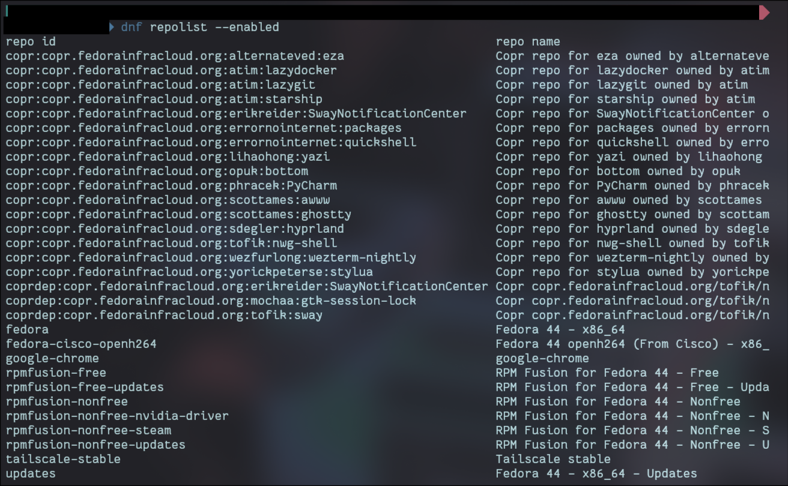
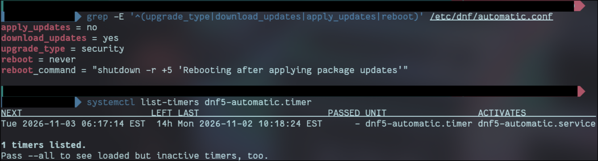

# 02 Packages and repos

- Fedora version: 44

## What it is

### 1. What is a repository, and what does `dnf` download from it before it installs anything?

`dnf` is Fedora's package manager, the same job `apt` does on Debian and Ubuntu: installing, updating, and removing software.

A repository is a server that stores software packages along with information about them. Instead of hunting for a random installer online, my machine points at trusted repos and downloads exactly what it needs from them.

Before installing anything, `dnf` downloads the repo's **metadata**: a small index starting from a file called `repomd.xml`, which points to compressed lists of every package, what each one depends on, and a checksum for each file. It is cached locally (`/var/cache/libdnf5` on dnf5).

`dnf` then compares that metadata against what I already have installed, works out every dependency needed, and only then shows the `Is this ok [y/N]:` prompt. After I type `y` it downloads the actual packages, checks each one against its checksum and GPG signature, and installs them.

### 2. What does `gpgcheck=1` protect me from? What could an attacker do if it were `0`?

`gpgcheck` is a per-repo setting. With `gpgcheck=1`, dnf checks the cryptographic signature on every package before installing it, using the repo owner's public key.

That proves two things: **authenticity** (the package was really built by whoever owns the key, for example the Fedora Project) and **integrity** (nobody changed it after it was signed).

This matters because Fedora packages are served by hundreds of volunteer-run mirrors around the world. The signature means I am trusting Fedora's key, not whoever runs the mirror.

With `gpgcheck=0`, dnf installs whatever it is given. An attacker who controls a mirror, spoofs a repo, or sits in the middle of the connection (an on-path or MITM attack) could hand me a modified package. Packages run install scripts as root, so a malicious package means full root access to my machine.

### 3. What is a Copr, and why is trusting one different from trusting the main `fedora` repo?

Copr is a build service run by the Fedora Project. Anyone can give it source code, and it builds the packages and hosts them as a repo.

Fedora runs the servers but does not review, test, or approve what is inside individual Coprs. Packages in the main `fedora` repo go through package review and are maintained by Fedora packagers. A Copr is only as trustworthy as the one person or small team who runs it.

Copr packages are still signed, and `gpgcheck=1` is on for mine. But that signature only proves the package came from that Copr project unchanged. It says nothing about whether the code itself is safe. So enabling a Copr means trusting its owner with root access to my machine, the same as running their install script.

## What my machine is doing

### Repo audit

|Repo|Enabled?|gpgcheck?|Installed packages from it|Do I use it?|
|---|---|---|---|---|
|`fedora`|Yes|1|<check count>|Yes, the base OS|
|`updates`|Yes|1|<check count>|Yes, every update since install|
|`fedora-cisco-openh264`|Yes|1|<check count>|Yes, video codec for the browser|
|Coprs (<list them>)|Yes|1|about 8 total|Most of them. A few I do not recognise yet|
|`google-chrome`|Yes|1|1 (`google-chrome-stable`)|Yes|
|RPM Fusion|Some|1|1 (<which package>)|Not right now, kept for future codecs and drivers|
|`tailscale`|Yes|1|1 (`tailscale`)|Yes, keeps it updated even while I have it switched off|

- Every enabled repo has `gpgcheck=1`.
- Hyprland comes from: <the `fedora` repo or a Copr, from the `grep -i hypr` command>
- I kept every repo. Each one either provides software I use or is a source I have a reason to keep. Nothing was disabled.



### Automatic security updates

Set up `dnf5-automatic` with:

- `upgrade_type = security`: only updates Fedora has marked as security fixes
- `download_updates = yes`, `apply_updates = no`: it downloads them, but I install them myself with `sudo dnf upgrade`. A laptop should not change itself in the middle of a session at the library.
- `reboot = never`

Fedora does not tag every fix as a security update, so I still run `sudo dnf upgrade` myself regularly.

## What I changed and why

|What|Command or file|Why|
|---|---|---|
|Installed the auto-update tool|`sudo dnf install dnf5-plugin-automatic`|Provides the timer and service|
|Configured it|`/etc/dnf/automatic.conf` (copy in `configs/`)|Security updates downloaded automatically, installed by me|
|Turned on the timer|`sudo systemctl enable --now dnf5-automatic.timer`|Runs the check every day without me remembering|
|Repo audit|none|Checked every repo's source, signing, and use. All kept.|

## Proof it works

The timer is scheduled, it ran successfully on demand, and the config shows my settings.


## Rollback

```bash
sudo systemctl disable --now dnf5-automatic.timer
sudo dnf remove dnf5-plugin-automatic
sudo rm -f /etc/dnf/automatic.conf.rpmsave
```

The repo audit changed nothing, so there is nothing to undo for it.