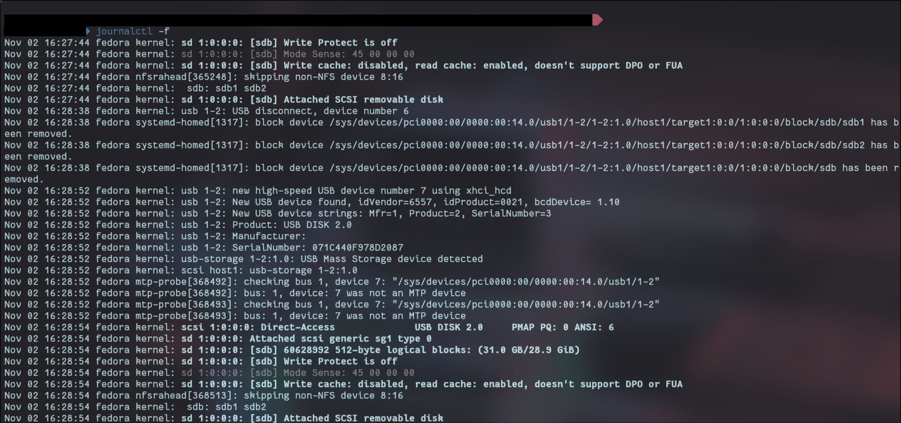
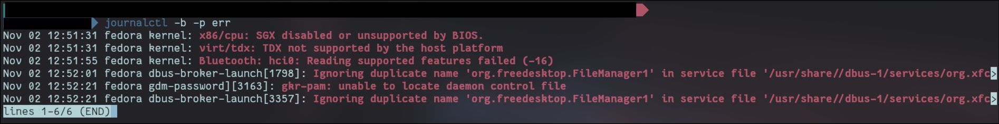
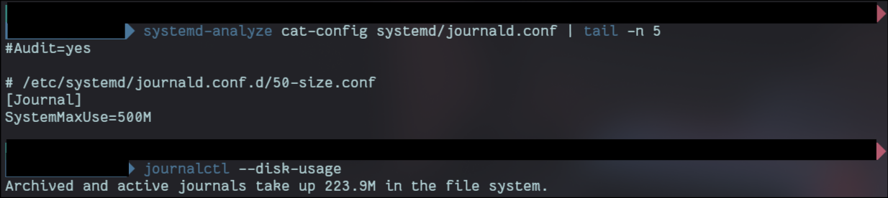

# 03 journalctl

## What it is

### 1. What is the journal, and how is it different from plain text log files in `/var/log`?

The journal is systemd's logging system. It collects messages from almost everything on the machine: the kernel, every service, and anything a program prints while it runs. It stores them in a binary format, so I read them with `journalctl` instead of `cat` or `less`.

Every entry carries structured fields, not just a line of text: a microsecond timestamp, the user ID (`_UID`), the process ID (`_PID`), the program name (`_COMM`), the systemd unit that produced it (`_SYSTEMD_UNIT`), and which boot it came from (`_BOOT_ID`). That is what makes filtering so precise.

Traditional logs in `/var/log` are plain text files written by a syslog daemon like rsyslog, usually one file per app or category, readable with `cat` or `less`. On a system running both, the journal sits upstream: it catches everything first and can forward copies to the syslog daemon. Fedora does not install rsyslog by default anymore, so on my machine the journal is the main log. The journal itself lives in `/var/log/journal/`.

### 2. What does "filter by boot" mean, and why is it useful after a crash or bad update?

Every time the machine starts, systemd gives that boot a unique ID, and every log entry is tagged with it. Filtering by boot means showing only the entries from one specific startup.

- `journalctl -b` or `-b 0`: the current boot
- `journalctl -b -1`: the previous boot (the one that crashed, for example)
- `journalctl -b -2`: two boots ago
- `journalctl --list-boots`: every boot the journal still remembers

Negative numbers count back from now. Positive numbers count forward from the oldest boot stored, so `-b 1` is the oldest boot on record, not the last one.

This is useful after a crash because a bad update can cause a kernel panic, freeze the GUI, or break a driver, forcing a hard reboot. Once the machine is back up, `journalctl -b -1 -p err` shows what went wrong during the boot that failed. The last lines before that log suddenly stops usually point straight at the component that broke. That tells me what to roll back, for example `dnf history undo` or booting the older kernel from the GRUB menu.

This only works because Fedora keeps the journal on disk. A journal kept only in RAM would be wiped by the crash.

### 3. Log priorities go from 0 to 7. What do the numbers mean, and what does `-p err` show?

Lower number means more serious.

|#|Name|Meaning|
|---|---|---|
|0|emerg|The system is unusable|
|1|alert|Something needs fixing right now|
|2|crit|Critical failure, like a hardware or core component failing|
|3|err|Something failed, but the rest of the system keeps running|
|4|warning|Not broken yet, but not right either|
|5|notice|Normal, but worth noting|
|6|info|Routine messages: "service started", "address assigned"|
|7|debug|Developer detail, mostly only printed when a program's debug mode is on|

`-p err` shows priority 3 **and everything more serious** (0 to 3). Warnings and below are hidden, so it is a quick list of everything that actually went wrong.

## What my machine is doing

- The journal remembers `47` boots (`journalctl --list-boots`).
- Before the cap, logs used `556.9M` (`journalctl --disk-usage`). Fedora's default limit is 10% of the filesystem, capped at 4G, so on my 235G disk the journal could have grown to 4G.
- `journalctl -f` showed the kernel detecting the USB stick live as I plugged it in.



### Errors from this boot

`journalctl -b -p err` showed mostly harmless noise. One error was related to Bluetooth that stood out to me. 

- **Where it comes from:** the `btusb` kernel driver, which runs the laptop's built-in Bluetooth chip.
- **What I tried:** reloading the driver and restarting the Bluetooth service:

```bash
sudo rmmod btusb                      # unload the Bluetooth driver
sudo modprobe btusb                   # load it again
sudo systemctl restart bluetooth      # restart the Bluetooth service
```

- **Result:** my Bluetooth headphones connect and work. The error line is still in the log because it was written earlier in this boot, and the journal never rewrites history. The real test is whether it shows up again after the next reboot:

```bash
journalctl -b -p err | grep -i bluetooth
```

- **Does it matter?** No. Bluetooth works, so this is a harmless message from the driver starting up, not a fault.



## What I changed and why

Capped how much disk space the journal can use, with a drop-in config file:

```bash
sudo mkdir -p /etc/systemd/journald.conf.d
printf '[Journal]\nSystemMaxUse=500M\n' | sudo tee /etc/systemd/journald.conf.d/50-size.conf
sudo systemctl restart systemd-journald
cp /etc/systemd/journald.conf.d/50-size.conf configs/
```

**Why 500M:** that still holds weeks of logs on a laptop, instead of letting them grow to 4G.

**Why a drop-in in `.conf.d/` instead of editing `journald.conf`:**

- **Easy to undo.** Deleting one small file reverses the change. No hunting through the main config to remember what I edited.
- **Survives updates.** The main config belongs to the systemd package, so an update can replace it or leave my edits stranded in a `.rpmnew` file. Updates never touch files I put in `.conf.d/`.
- **Clear.** Anyone can see exactly what I changed by looking at one file.
- **How it works:** systemd reads the main file first, then every `.conf` file in `journald.conf.d/` in alphabetical order. Later files win, which is why drop-ins get number prefixes like `50-`.

## Proof it works

`systemd-analyze cat-config` shows every file journald reads, in order. My drop-in is read last, so its setting wins.



After the restart, `journalctl --disk-usage` reports `223.9M`.

## Rollback

```bash
sudo rm /etc/systemd/journald.conf.d/50-size.conf && sudo systemctl restart systemd-journald
```

The Bluetooth driver reload changed nothing permanent, so there is nothing to undo for it.