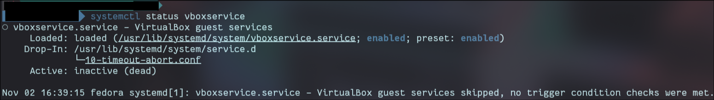
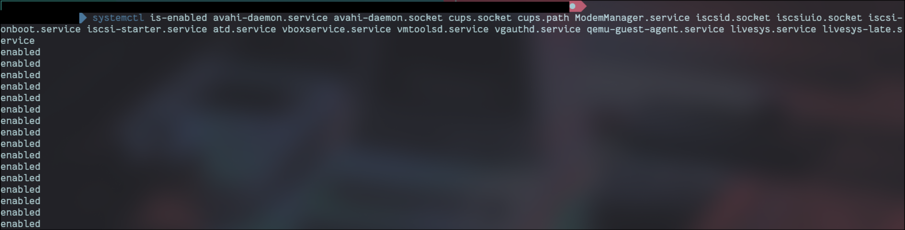
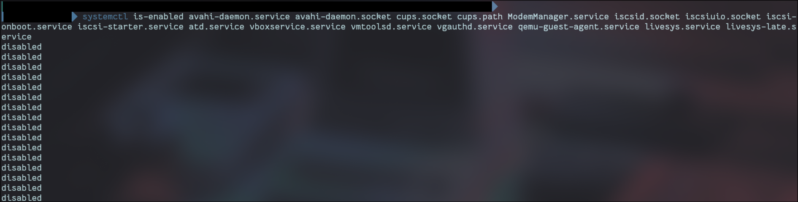
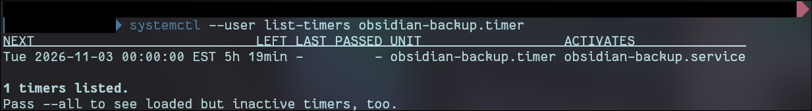
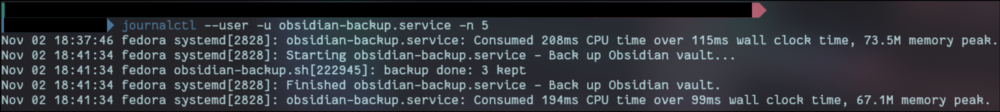

# 04 systemd

## What it is

### 1. What is a unit? Name three types (service, socket, timer) and what each one is for.

A unit is a standardized configuration file that describes one thing systemd can track and control. The file ending says what kind of thing it is: `.service`, `.socket`, `.timer`, `.mount`, and so on.

systemd does not contain things like filesystem drivers itself. A unit just tells it what to do. For example, `boot-efi.mount` says: "take the partition with this UUID and mount it at `/boot/efi` using the VFAT driver during boot." Most mount units are generated automatically from `/etc/fstab`.

- **Service units** run and manage background programs (daemons), applications, or startup scripts.
- **Socket units** are for on-demand activation. Instead of a service running in the background all the time using RAM, systemd opens a "listening post" (a socket). When something connects to it, systemd starts the matching service to handle it.
- **Timer units** schedule tasks by time or by events, replacing the old `cron` system from Unix. They act like alarm clocks for service units: they tell systemd to start a specific service at a specific moment.

### 2. What is the difference between `start`, `enable`, and `mask`?

|Command|What it does|Survives a reboot?|
|---|---|---|
|`start`|Runs the unit **right now** (`stop`, `restart`, `reload` are its partners)|No. After a reboot it is not running unless it is also enabled|
|`enable`|Makes the unit start **automatically at boot**, by creating a link in a `.wants/` folder. Does not start it now unless I add `--now`|Yes|
|`mask`|Links the unit to `/dev/null` so **nothing** can start it: not at boot, not by hand, not as a dependency of another unit. `unmask` reverses it|Yes|

`disable` only removes the boot link. Something else can still start a disabled unit. `mask` is the stronger lock.

### 3. How does a timer start a service, and what problem does `Persistent=true` solve on a laptop?

A `.timer` file activates the `.service` file with the same name by default, so `obsidian-backup.timer` starts `obsidian-backup.service`. The timer holds the schedule; the service holds the actual job.

There are two kinds of timers:

- **Realtime**: wall-clock times, set with `OnCalendar=` (for example `daily`, which means midnight)
- **Monotonic**: relative to an event, like `OnBootSec=10min` (10 minutes after boot) or `OnUnitActiveSec=1h` (an hour after the last run)

`Persistent=true` is insurance for laptops. systemd saves the time of the last run to disk. If the laptop was off or asleep when the timer should have fired, the job runs as soon as the laptop is back on, instead of being skipped until the next cycle. It applies to `OnCalendar=` timers.

## What my machine is doing

### Boot service audit

`systemctl list-unit-files --state=enabled` lists 121 units (full list: `outputs/enabled-before.txt`). Most are core parts of the OS. I grouped them instead of judging all 121 one by one, and only looked closely at the ones worth questioning.

**Not needed: things I do not use**

|Unit(s)|What it does|Why I disabled it|
|---|---|---|
|`avahi-daemon.service`, `avahi-daemon.socket`|Announces this laptop on the local network and finds printers and devices (mDNS)|Listens on the network (UDP 5353) on every Wi-Fi I join, including public ones. I do not use network printers or local device discovery.|
|`cups.socket`, `cups.path`|Printing. `cups.service` itself is not enabled; these two start it on demand|I do not print from this laptop. Good example of socket activation: disabling only `cups.service` would do nothing.|
|`ModemManager.service`|Manages cellular (4G/5G) modems|No SIM slot or cellular modem|
|`iscsid.socket`, `iscsiuio.socket`, `iscsi-onboot.service`, `iscsi-starter.service`|iSCSI: using disks over the network, mostly for servers|No network storage|
|`atd.service`|Runs one-off jobs scheduled with the `at` command|`atq` is empty, I have never used it|

**Leftovers that never actually run**

These are enabled but skip themselves every boot, because a built-in condition is not met. Disabling them is cleanup, not a security change.

|Unit(s)|What it is for|Why it never runs|
|---|---|---|
|`vboxservice.service`|VirtualBox guest tools|Only runs inside a VirtualBox VM|
|`vmtoolsd.service`, `vgauthd.service`|VMware guest tools|Only runs inside a VMware VM|
|`qemu-guest-agent.service`|QEMU/KVM guest tools|Only runs inside a KVM VM|
|`livesys.service`, `livesys-late.service`|Sets up the live USB session|Left over from the installer USB. Only runs when booted from it|

`systemctl status vboxservice` shows it: enabled, but "skipped, no trigger condition checks were met".



**Kept, worth knowing about**

|Unit(s)|What it does|Why I kept it|
|---|---|---|
|`mullvad-daemon`, `mullvad-early-boot-blocking`|VPN, and blocking traffic until the VPN is up at boot|I use Mullvad every day|
|`tailscaled.service`|Tailscale|Off for now, but I will use it again|
|`bluetooth.service`|Bluetooth|Headphones|
|`rsyslog.service`, `logrotate.timer`|Copies journal messages to text files in `/var/log` and rotates them|Installed on my machine, so the journal is not the only log here (correction to module 03)|
|`abrt*` (5 units)|Collects crash reports to send to Fedora|Useful for bug reports. Crash dumps can contain memory contents, so I only send reports I have looked at|
|`sssd.service`, `sssd-kcm.socket`|Login against company directories like Active Directory|Fedora default, harmless when not configured|
|`virt*` sockets and `virtqemud`|libvirt, for running VMs|Local only, start on demand. Not exposed to the network|
|`tuned`, `tuned-ppd`|Power management|Replaced by TLP in module 08|
|`smartd.service`|Warns me if the SSD starts failing|Keep|
|`chronyd.service`|Keeps the clock correct|Wrong time breaks HTTPS and makes logs useless|
|`NetworkManager-wait-online`|Makes boot wait until the network is connected|Slows boot a little. Kept for now|

**Core system, not touched**

- **Login and desktop:** `gdm`, `getty@`, `accounts-daemon`, `dbus`, `rtkit-daemon`, `uresourced`
- **Network and security:** `NetworkManager`, `firewalld`, `auditd`, `audit-rules`, `systemd-resolved`, `fips-crypto-policy-overlay`, `authselect-apply-changes`, `selinux-autorelabel-mark`
- **Hardware:** `upower`, `udisks2`, `thermald`, `intel_lpmd`, `irqbalance`, `lm_sensors`, `mcelog`, `switcheroo-control`, `pcscd.socket`, `input-remapper`
- **Disk and storage:** `lvm2-*`, `dm-event`, `mdmonitor`, `raid-check.timer`, `fstrim.timer` (harmless with no LVM or RAID; part of the base system)
- **Scheduled jobs:** `crond`, `dnf-makecache.timer`, `dnf5-automatic.timer` (mine, module 02), `plocate-updatedb.timer`, `unbound-anchor.timer`
- **Everything starting `systemd-`**: core systemd, never disable

## What I changed and why

### 1. Disabled 16 units I do not need

```bash
sudo systemctl disable --now avahi-daemon.service avahi-daemon.socket cups.socket cups.path ModemManager.service iscsid.socket iscsiuio.socket iscsi-onboot.service iscsi-starter.service atd.service
sudo systemctl disable vboxservice.service vmtoolsd.service vgauthd.service qemu-guest-agent.service livesys.service livesys-late.service
```

Every service that runs is something that can break or be attacked. Turning off what I do not use shrinks that. The biggest win is `avahi-daemon`, the only one of these that was listening on the network.

The first command uses `--now` to stop them as well. The leftovers in the second command were never running, so they only needed the boot link removed.

### 2. Daily backup of my Obsidian vault

A user timer (runs as me, no root) that makes a compressed, dated copy of the vault every day and keeps the newest 14:

- `~/.local/bin/obsidian-backup.sh`: the script (copy in `configs/`)
- `~/.config/systemd/user/obsidian-backup.service`: runs the script once (`Type=oneshot`)
- `~/.config/systemd/user/obsidian-backup.timer`: `OnCalendar=daily` and `Persistent=true`

**Why, when the vault already syncs to GitHub:** sync keeps one current copy. If a bad sync overwrites or deletes something, sync spreads the damage. These backups are dated snapshots I can go back to.

**Limitation:** the backups sit on the same disk as the vault. If the SSD dies or the laptop is stolen, they are gone too. GitHub sync is my off-machine copy.

**First run failed, and that was good:** the script still had the placeholder `<vault-folder-name>`, so `tar` could not find the folder. Because the script starts with `set -euo pipefail`, it stopped at that error instead of carrying on and reporting a successful backup of nothing. The `set -euo pipefail` command ensures script safety by instantly aborting execution if any individual command fails (`-e`), if any undefined variable is referenced (`-u`), or if any component within a chain of piped commands encounters an error (`-o pipefail`)

## Proof it works

**Services disabled.** Before (all enabled) and after (all disabled):





**Timer scheduled.** Next run is midnight tonight:



**Backup ran.** The journal shows the service starting, the script reporting `backup done`, and the service finishing cleanly:



**Backup restores.** Extracted the newest backup to `/tmp/restore` and my project folders are all there. A backup I have never restored is just a guess.


## Rollback

Re-enable the disabled units:

```bash
sudo systemctl enable --now avahi-daemon.service avahi-daemon.socket cups.socket cups.path ModemManager.service iscsid.socket iscsiuio.socket iscsi-onboot.service iscsi-starter.service atd.service
sudo systemctl enable vboxservice.service vmtoolsd.service vgauthd.service qemu-guest-agent.service livesys.service livesys-late.service
```

Remove the backup timer:

```bash
systemctl --user disable --now obsidian-backup.timer
rm ~/.config/systemd/user/obsidian-backup.{service,timer} ~/.local/bin/obsidian-backup.sh
systemctl --user daemon-reload
```