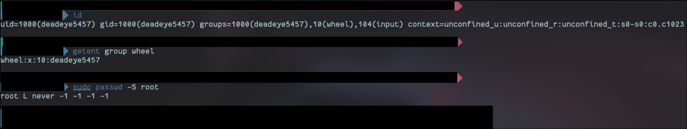
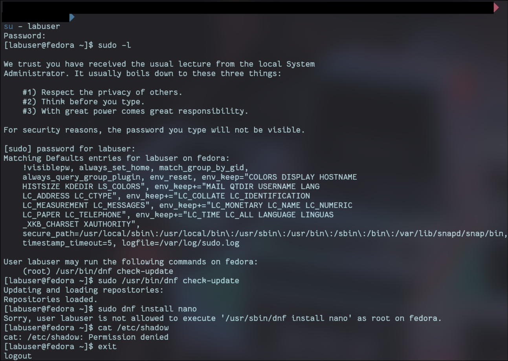
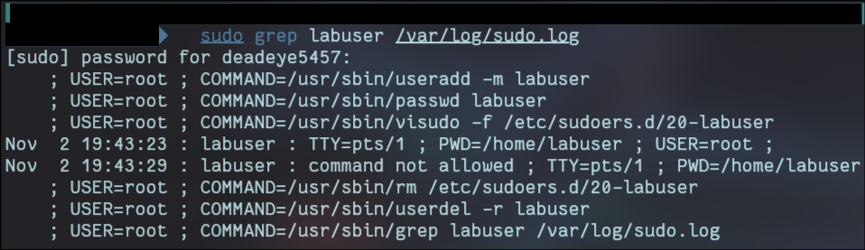

# 05 Users, groups, sudoers

## What it is

### 1. What is the difference between `/etc/passwd`, `/etc/shadow`, and `/etc/group`?

|File|What is in it|Who can read it|
|---|---|---|
|`/etc/passwd`|One line per account: username, user ID (UID), main group ID, home folder, and login shell. The password field just says `x`, meaning "look in shadow"|Everyone. Programs need it to turn UIDs into names|
|`/etc/shadow`|The password **hashes**, plus password aging rules (when it was last changed, when it expires). `!` or `*` means the account cannot log in with a password|Root only. That is why `cat /etc/shadow` failed for labuser|
|`/etc/group`|One line per group: group name, group ID (GID), and its members. Mine has `wheel:x:10:deadeye5457`|Everyone|

Hashes used to live in `/etc/passwd`, but because that file has to be readable by everyone, anyone could copy the hashes and try to crack them offline. Moving them to a root-only file fixed that.

### 2. Read `%wheel ALL=(ALL) ALL` out loud in plain English. What does each part mean?

"Any user in the `wheel` group may, on any machine, run any command as any user."

|Part|Meaning|
|---|---|
|`%wheel`|**Who** it applies to. The `%` means a group, not a single user|
|`ALL=`|**Where**: on any host. Matters when one sudoers file is shared across many machines|
|`(ALL)`|**As whom**: they can run commands as any user, root included|
|`ALL`|**What**: any command|

It is the one line that turns being in the `wheel` group into full administrator access.

### 3. Why should sudoers only ever be edited with `visudo`?

sudo reads its rules every time it runs. If `/etc/sudoers`, or any file in `/etc/sudoers.d/`, has a syntax error, sudo refuses to run at all. On Fedora root's password is locked, so sudo is the only way to get admin rights, and that leaves no easy way to fix the file.

`visudo` prevents that. It:

- edits a temporary copy instead of the real file
- checks the syntax before saving, and will not save a broken file
- locks the file so two people cannot edit it at the same time
- creates files with the right permissions (see below)

If I edited it with `nano` and saved a mistake, getting sudo back would mean a root shell I already had open, or rebooting into recovery mode. That is why I kept a second terminal open with `sudo -i` during this module.

### 4. Why is a rule allowing `less` or `vim` as root as bad as giving full root?

These programs can run other commands. In `less` you can type `!sh`, and in `vim` `:!sh`, to open a shell. If `less` is running as root through sudo, that shell is a root shell, and the user now has full root even though the rule only mentioned `less`.

[GTFOBins](https://gtfobins.github.io/) lists hundreds of common programs that can be escaped like this. The safe way to let someone edit a root-owned file is `sudoedit`, which copies the file, lets the user edit the copy as themselves, and writes it back.

## What my machine is doing

- My user `deadeye5457` is in `wheel`, so it has full sudo through the `%wheel ALL=(ALL) ALL` rule. It is the only member of `wheel`.
- root's password is locked (`L` in `passwd -S root`). Nobody can log in as root directly; admin access only goes through sudo, which is logged and tied to a named user.
- Accounts that can log in with a shell: root, sync, shutdown, halt, and deadeye5457



## What I changed and why

### 1. Tighter sudo defaults

`/etc/sudoers.d/10-hardening` (copy in `configs/`):

```
Defaults timestamp_timeout=5
Defaults logfile="/var/log/sudo.log"
```

- `timestamp_timeout=5`: after I type my password, sudo trusts me for 5 minutes, then asks again. If I walk away from the laptop, an open terminal does not stay admin for long.
- `logfile="/var/log/sudo.log"`: every sudo command, allowed or refused, goes into its own log file, on top of the journal. One place to check who did what as root.

**Permissions problem:** `visudo -c` first reported `bad permissions, should be mode 0440`. I fixed it with:

```bash
sudo chown root:root /etc/sudoers.d/10-hardening
sudo chmod 0440 /etc/sudoers.d/10-hardening
```

`0440` means root and the root group can read it, nobody can write it, and everyone else gets nothing. sudo refuses rule files that look writable, because anyone who can write a sudoers file can give themselves root.

### 2. Tested least privilege with a throwaway user

Created `labuser` and gave it exactly one root command in `/etc/sudoers.d/20-labuser`:

```
labuser ALL=(root) /usr/bin/dnf check-update
```

|As labuser|Result|Why|
|---|---|---|
|`sudo -l`|Lists only `/usr/bin/dnf check-update`|That is the only rule for this user|
|`sudo /usr/bin/dnf check-update`|Allowed|Exactly matches the rule|
|`sudo dnf install nano`|Refused|Same program, different arguments. A rule with arguments only allows those exact arguments|
|`cat /etc/shadow`|Permission denied|No sudo used, and shadow is root only|

Then deleted the rule and the user:

```bash
sudo rm /etc/sudoers.d/20-labuser
sudo userdel -r labuser
```

## Proof it works

`sudo -l` as labuser also shows my new defaults in effect (`timestamp_timeout=5, logfile=/var/log/sudo.log`), and every test result:



The sudo log records labuser's refused command:



## Rollback

```bash
sudo rm /etc/sudoers.d/10-hardening
```

The labuser test was already cleaned up, so there is nothing else to undo.